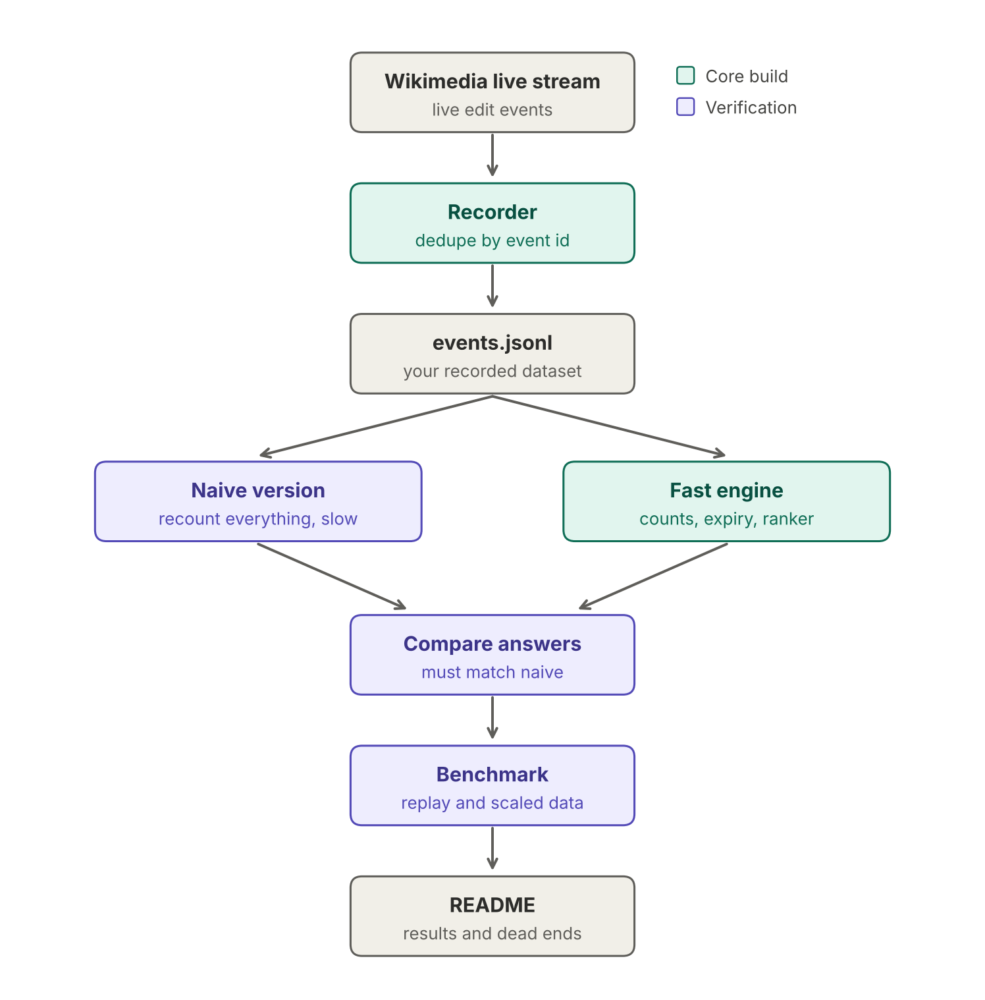

# The trending engine

A live feed shows thousands of events per second. At any moment, you want to know which items are getting the most activity right now, and you want the answer instantly.

# Repo  structure: 
trending/
  README.md        # paste the problem statement from my last message
  capture/         # script that records the live stream
  data/            # recorded events (keep out of git, add to .gitignore)
  naive/           # slow, obviously-correct version
  engine/          # your fast version, later
  tests/
  bench/